<div align="center">

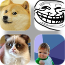

# MemeOS

**A desktop operating system that runs in one browser tab.**<br>
Window manager, persistent file system, terminal, task manager, apps, and an undisclosed number of easter eggs.<br>
No build step, no server, no accounts. Much window. Very file. Wow.

<a href="https://eneserdo.github.io/memeos/"></a>


<a href="LICENSE"></a>

<br>

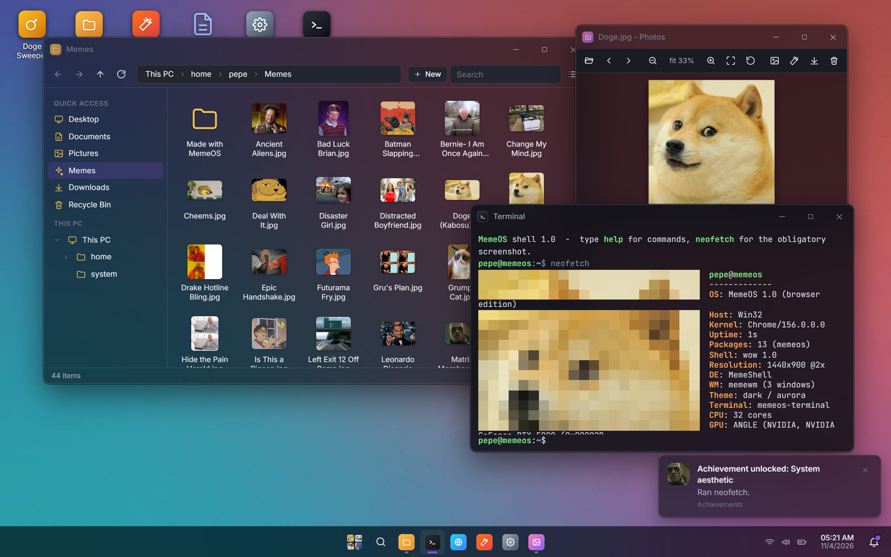

</div>

<br>

MemeOS looks like a toy and behaves like a system. Files you create are written to IndexedDB and are still there after a
reload. The Recycle Bin restores what you deleted. The Terminal is a real shell over the same file system. The Task
Manager does not fake its numbers: it measures how long each window spends inside its event handlers, counts frames,
and reads the JavaScript heap. The memes are the decoration, not the trick.

<table>
<tr>
<td width="50%" valign="top">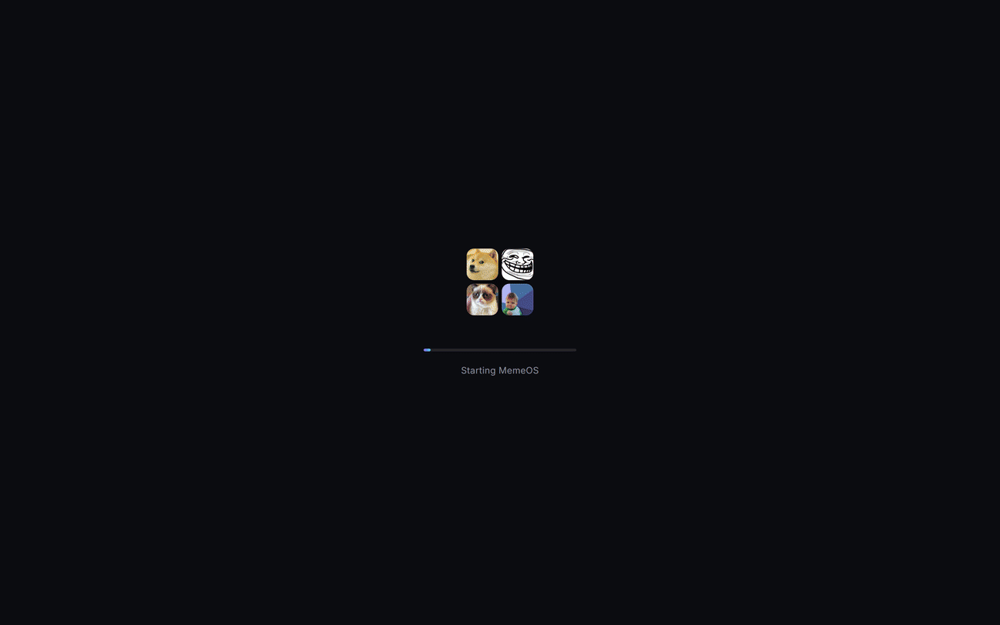</td>
<td width="50%" valign="top">

### Boot it

Open **[eneserdo.github.io/memeos](https://eneserdo.github.io/memeos/)** or clone the repo and serve the folder:

```sh
git clone https://github.com/eneserdo/memeos.git
cd memeos
python tools/serve.py        # http://127.0.0.1:8765
```

Any static server works (the page is ES modules, so `file://` does not). First boot seeds a home folder with
documents, 43 meme pictures and a few surprises, then drops you on the lock screen. Press Enter.

Useful URL flags: `?fast` skips the boot animation, `?nolock` skips the lock screen, `?open=terminal,files`
launches apps at start.

</td>
</tr>
</table>

## What is in the box

<table>
<tr>
<td width="50%">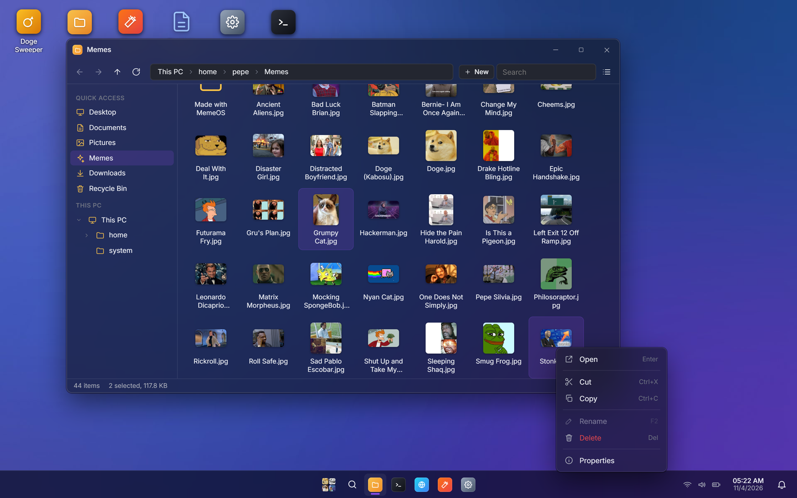</td>
<td width="50%">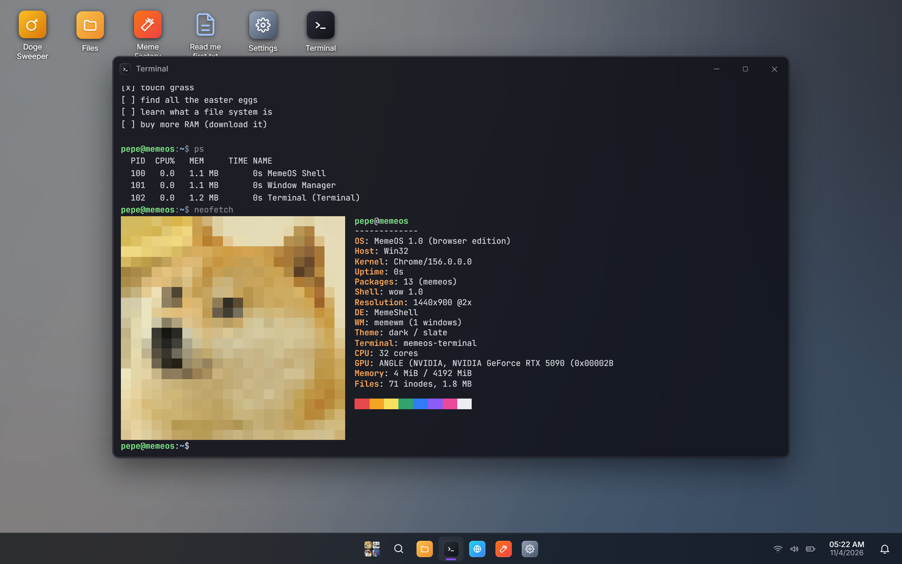</td>
</tr>
<tr>
<td valign="top">

**Files.** Sidebar with quick access and a folder tree, breadcrumbs you can click or type into, icon and detail views,
sorting, search, multi-select, rename, cut/copy/paste, drag and drop between folders, windows and the desktop. Drop a
picture from your real computer onto it to import it; right-click any file to download it back. The Recycle Bin keeps the
original location so Restore puts things back where they were.

</td>
<td valign="top">

**Terminal.** `ls`, `cd`, `cat`, `tree`, `mkdir`, `touch`, `rm`, `mv`, `cp`, `grep`, `find`, `du`, `df`, `ps`, `kill`,
`open`, `write`, `append`, `history`, tab completion, `&&`, environment variables, and `neofetch` that renders the
actual Doge picture as pixel art. `rm` sends things to the Recycle Bin like a civilised shell. `rm -rf /` is handled
with the seriousness it deserves.

</td>
</tr>
<tr>
<td width="50%">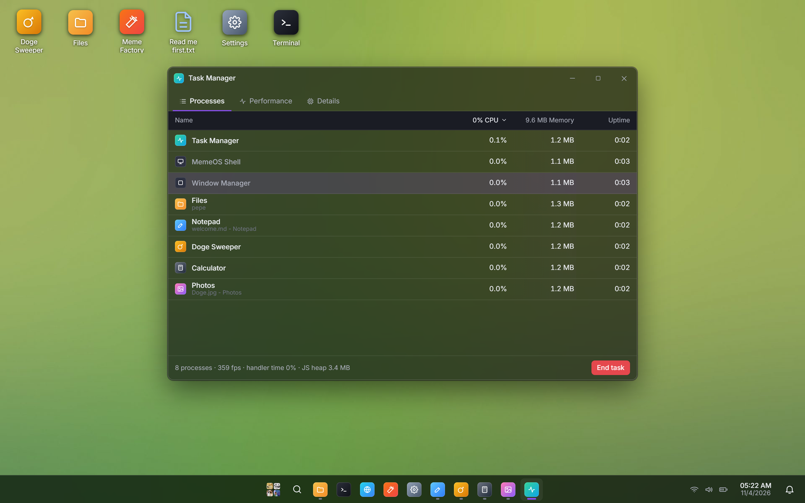</td>
<td width="50%">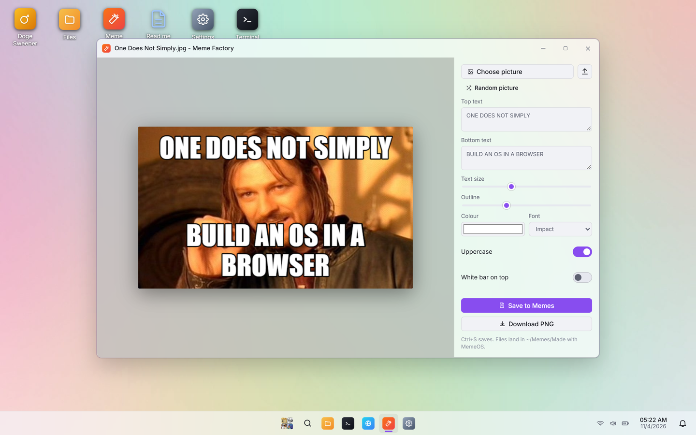</td>
</tr>
<tr>
<td valign="top">

**Task Manager.** Every window is a process with a PID. CPU is the measured time a window's handlers, timers and
animation frames took in the last second. Memory is an estimate from DOM nodes plus loaded file bytes, labelled as such.
The Performance tab graphs handler time, frame rate, JS heap (Chromium) and storage. End task ends tasks.

</td>
<td valign="top">

**Meme Factory.** Pick any picture from the file system or your computer, type top and bottom text, choose font,
size, outline and colour, and save the PNG to `~/Memes/Made with MemeOS`. Impact font, white fill, black outline, the
way the ancients intended.

</td>
</tr>
<tr>
<td width="50%">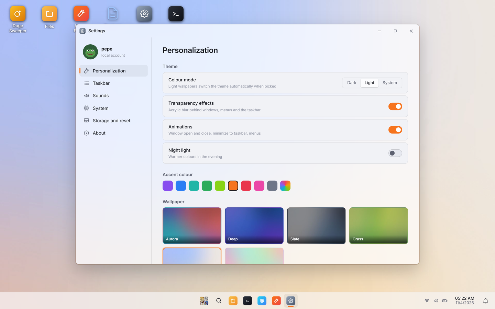</td>
<td width="50%">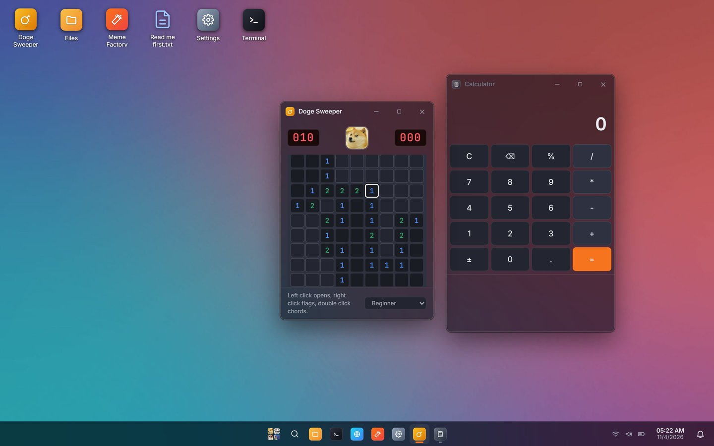</td>
</tr>
<tr>
<td valign="top">

**Settings.** Dark, light or system theme, nine accent colours or your own, six generated wallpapers or any picture,
acrylic transparency, animations, night light, taskbar alignment, synthesised UI sounds with a volume slider, storage
usage straight from `navigator.storage`, and a factory reset that really erases everything.

</td>
<td valign="top">

**Also:** Notepad with Markdown preview and Ctrl+S into the file system. Photos with zoom, pan, rotate and folder
navigation. Calculator with keyboard input and history. Doge Sweeper, a complete Minesweeper where the mines are dogs
and the first click is always safe. Surf, a browser inside the browser for the few sites that allow it. Achievements.
Run (Alt+R). About.

</td>
</tr>
</table>

## The window manager

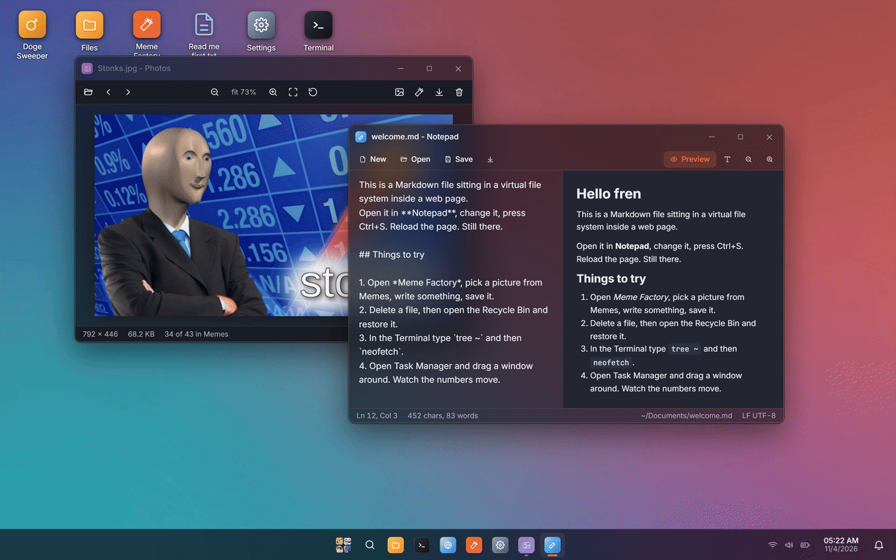

Drag by the title bar, resize from all eight edges, double-click to maximize. Drag a window into the left or right edge
to snap it to half the screen, or into the top edge to maximize. Minimize animates into the taskbar button and comes
back from there. Alt+W cycles windows with a switcher overlay (Alt+Tab belongs to your real operating system). The
taskbar shows pinned and running apps, groups multiple windows of one app, and has right-click menus everywhere you would
expect them. Quick settings, a calendar and a notification centre live in the tray.

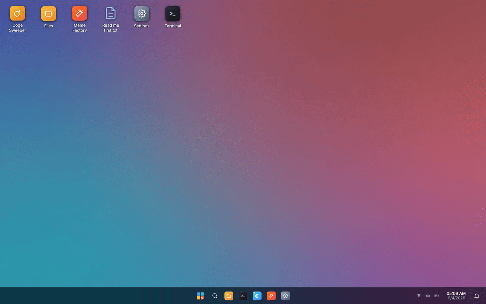

The start menu searches apps, files, settings pages and does arithmetic. Recommended shows what you opened last.

### Keyboard

| Keys | Action | Keys | Action |
|---|---|---|---|
| `Alt+S` | Start menu | `Alt+N` | Minimize window |
| `Alt+W` / `Alt+Shift+W` | Switch windows | `Alt+X` | Close window |
| `Alt+T` | Terminal | `Alt+Enter` | Maximize / restore |
| `Alt+E` | Files | `Alt+Arrows` | Snap left / right / up, restore down |
| `Alt+R` | Run | `Alt+D` | Show desktop |
| `Alt+M` | Task Manager | `Alt+L` | Lock |
| `F2` / `Delete` | Rename / delete selection | `Ctrl+S` | Save (Notepad, Meme Factory) |

## Easter eggs

<table>
<tr>
<td width="50%">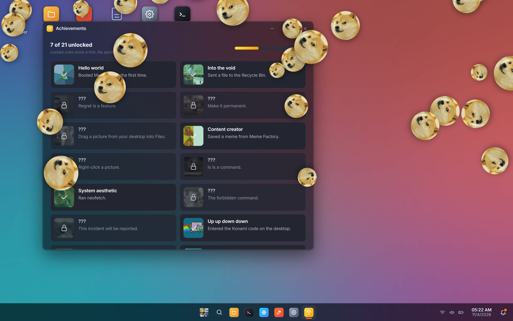</td>
<td width="50%">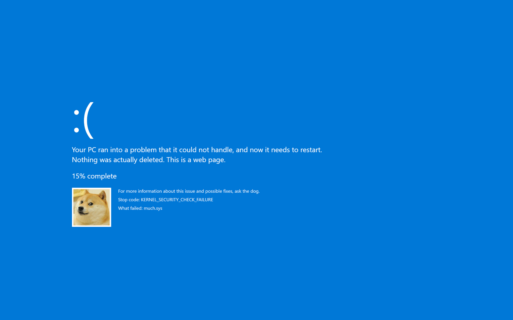</td>
</tr>
</table>

There are 21 achievements. The Achievements app shows a hint for each locked one and nothing more. A few that are
safe to mention: the Konami code works on the desktop, the Terminal knows `fortune`, `cowsay`, `dogesay`, `sl`,
`matrix`, `sudo` and a word from a hidden file, the calculator notices the number, the screensaver starts after two idle
minutes and the corners count, and the forbidden command produces the screen above and deletes nothing.

<details>
<summary>Full spoilers</summary>

| Achievement | How |
|---|---|
| Hello world | Boot for the first time |
| Into the void | Delete a file |
| Undo culture | Restore a file from the Recycle Bin |
| No witnesses | Empty the Recycle Bin |
| Smuggler | Import a file from your computer (drop it on Files or the desktop) |
| Content creator | Save a meme from Meme Factory |
| Interior design | Right-click a picture, Set as wallpaper |
| Hackerman | Run ten terminal commands, or type `hackerman` |
| System aesthetic | `neofetch` |
| Speedrun any% | `rm -rf /` (add `--no-preserve-root` for the full experience) |
| Not in the sudoers file | `sudo anything` (`sudo make me a sandwich` is honoured) |
| Up up down down | Konami code on the desktop |
| Much type | Type `doge` on the desktop |
| Nice | Type 80085 on the calculator |
| Minesweeper, but dog | Win a game of Doge Sweeper |
| Task failed successfully | End a task in the Task Manager, or `kill PID` |
| Tidy | Snap a window to a screen edge |
| Curiosity | Show hidden files, open `~/.secrets/do not open.txt` |
| AFK | Let the screensaver hit a corner |
| Goodnight | Shut down from the start menu |
| Completionist | All of the above |

Also: the clock turns green at 13:37, the start menu answers `wow`, and searching `doge` rains.

</details>

## How it works

```
index.html                 one page, ES modules, no bundler
css/        base (tokens, themes, controls) · shell · windows · apps
js/core/    bus · settings · sound (WebAudio) · fs (IndexedDB) · ui (menus, dialogs, toasts, file picker)
            wm (windows, processes, drag, resize, snap) · apps (registry, launch, file associations) · eggs · seed
js/shell/   desktop · taskbar · start · flyouts (quick settings, calendar, notifications) · power · shortcuts
js/apps/    files · notepad · terminal · photos · taskman · settings · calc · factory · sweeper · surf · misc
assets/     logo and avatars (SVG) · generated wallpapers · 43 seed memes with manifest
tools/      serve.py · e2e.py (Playwright) · shots.py (README images) · fetch_assets.py · make_wallpapers.py
```

- **File system.** A tree of nodes in one IndexedDB store, mirrored in memory for synchronous lookups. Text is stored as
  strings, imported files as Blobs, the seed memes as references to `assets/` so they cost nothing until you edit them.
  Trash is a hidden folder; each trashed node remembers its original path.
- **Windows and processes.** A `Win` owns a DOM subtree and a `Proc`. The process accumulates time between the
  capture and bubble phase of events on its window root, plus wrapped timers and animation frames, and the scheduler
  turns that into a percentage once per second. That number is what the Task Manager shows.
- **Apps** register with `registerApp({ id, name, icon, color, mount(win, proc, args) })` and get a window body, a
  process for timers, and hooks for close, focus and resize. Adding an app is one file in `js/apps/` and one import.
- **Settings** are one JSON object in localStorage applied as data attributes and CSS custom properties on `<html>`,
  which is how themes, accents, transparency and the animation switch work without touching the apps.
- **Sounds** are synthesised with WebAudio oscillators. There are no audio files.

Tested in Chromium-based browsers (Chrome, Edge) with the Playwright suite in `tools/e2e.py`. Firefox and Safari
should work since nothing exotic is used, but they are not part of the test run; open an issue if something is off.
`window.memeos` exposes the file system, settings, windows and launcher if you want to
poke at it from the console.

## Development

```sh
python tools/serve.py                 # dev server with correct MIME types
python tools/e2e.py                   # Playwright smoke test: boot, fs, every app, wm, terminal, persistence
python tools/shots.py [name ...]      # regenerate README screenshots and GIFs
python tools/fetch_assets.py          # re-download the seed memes (Imgflip templates, Know Your Meme)
python tools/make_wallpapers.py       # regenerate the wallpapers
```

## Credits

Code is MIT. The meme pictures belong to their creators and are listed with sources in
[ATTRIBUTION.md](ATTRIBUTION.md); they are illustrations, not part of the system, and will be removed on request.
Fonts: Inter, JetBrains Mono and Anton via Google Fonts. The logo is four of those pictures (Doge, Trollface, Grumpy Cat, Success Kid) in a
tile grid. Everything else, including the icons, avatars and wallpapers, was drawn or generated for this project.
